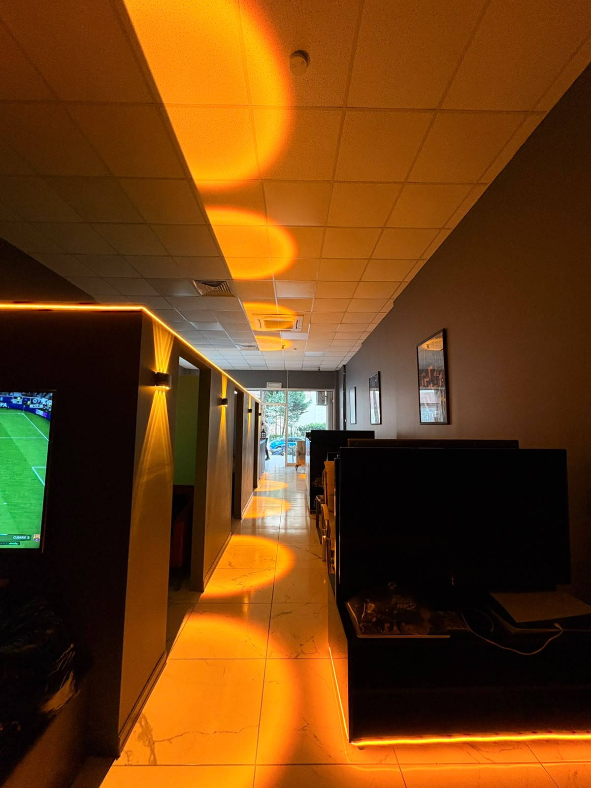

# NEO GAME CAFE & LOUNGE // BEYLİKDÜZÜ

> **Social Gaming Lounge, Turnuva Bilardo Arenası, Dijital QR Menü & Artisan Kafe**  
> *Barış Mahallesi, Konformist Residence, Beylikdüzü / İstanbul*



---

## 📌 Proje Hakkında

**NEO GAME CAFE & LOUNGE**, Beylikdüzü'nde PlayStation 5 VIP oyun locaları, alt kat profesyonel turnuva bilardo masaları, zengin masaüstü kutu oyunları arşivi ve artisan espresso barını tek çatı altında birleştiren yeni nesil sosyal yaşam merkezinin resmi web platformudur.

Tasarım dili: **Radical Kinetic Editorial** (Google Stitch uyumlu koyu karbon yüzeyler, mimari tipografi ve kan kırmızısı vurgular).

---

## 🎮 Temel Özellikler

- **Anlık Canlı Video Sahnesi (Hero Stage):** HTTP 206 Partial Content akışı ile 0 milisaniye poster gecikmesiyle doğrudan başlayan kurucu tanıtım videosu ve interaktif ses kontrolü.
- **Masaya Özel Dijital Menü (QR Kod Sistemi):** Masalardaki akrilik standlardan telefon kamerasıyla anında taranabilen, mobil uygulama indirme gerektirmeyen, %100 güncel dijital menü.
- **Özel Salon Kampanyası:** *2 Saat ve Üzeri Oyun Oynayana Sıcak Patlamış Mısır ve Kutu Coca-Cola Ücretsiz!* (%100 hediye ikram).
- **Mekan ve Atmosfer Galerisi (Bento Grid):** 5 farklı açıyla (Dış cephe, VIP PS5 salonları, Bar & Kafe, Koridor ve Orijinal LED tabela) tam ekran interaktif Lightbox inceleme deneyimi.
- **Karanlık Tema İnteraktif Harita (MapLibre GL):** Carto Dark Matter vektör harita, özel animasyonlu pin ve tek tıkla Google Haritalar yol tarifi.
- **Sıfır Çökme & Güvenlik Korumalı Statik Sunucu:** Dizin aşma (path traversal) saldırılarına karşı korumalı, Range akışı sınır denetimli, modern güvenlik başlıklarına (`nosniff`, `SAMEORIGIN`) sahip yerleşik Node.js sunucusu.

---

## ☕ Doğrulanmış Menü & İkramlar

* **Kahveler (100 ₺ / 150 ₺):** Ice Latte, Ice Americano, Cold Brew, Latte, Espresso (Single / Double), Demleme Çay (40 ₺)
* **Soğuk İçecekler:** Coca-Cola (80 ₺), Red Bull (100 ₺), Ice Tea (80 ₺), Çamlıca Gazoz (50 ₺), Maden Suyu (40 ₺), Doğal Kaynak Suyu (20 ₺)
* **Mutfak & Tostlar:** Kaşarlı Tost (150 ₺), Karışık Tost (220 ₺), Karışık Bol Sucuklu Tost (240 ₺), Tavuk Pilav (220 ₺)

---

## 🚀 Yerel Kurulum & Çalıştırma

Projeyi yerel makinenizde çalıştırmak için:

```bash
# Depoyu klonlayın
git clone https://github.com/kuzeyeskiar/neo-game-cafe-lounge.git
cd neo-game-cafe-lounge

# Bağımlılıkları yükleyin (gerekirse)
npm install

# Statik güvenli sunucuyu başlatın
node serve.js
```

Tarayıcınızda açın:
- **Yerel Adres:** `http://localhost:3456`
- **Ağ Adresi:** `http://192.168.0.44:3456`

---

## 🧪 Otomatik Test & Denetim

Tüm iş kuralları, fiyatlar, menü görselleri, güvenlik başlıkları ve yasaklı sahte iddia kontrollerini doğrulamak için:

```bash
node test-verify.js
```

---

## 📍 İletişim & Konum

* **Adres:** Barış Mah. Akdeniz Cad. Kır Çiçeği Sk. Konformist Residence No: 12/A, Beylikdüzü / İstanbul
* **Referans:** Makyol Starbucks karşısı, Mikel Cafe yanı, Metrobüs yürüme mesafesi.
* **Telefon:** [+90 531 586 99 66](tel:+905315869966)
* **Çalışma Saatleri:**
  - Pazartesi – Perşembe: 10:00 – 02:00
  - Cuma – Pazar: 10:00 – 03:00

---

## 📄 Lisans & Telif Hakkı

© 2026 NEO GAME CAFE & LOUNGE. Tüm hakları saklıdır.
